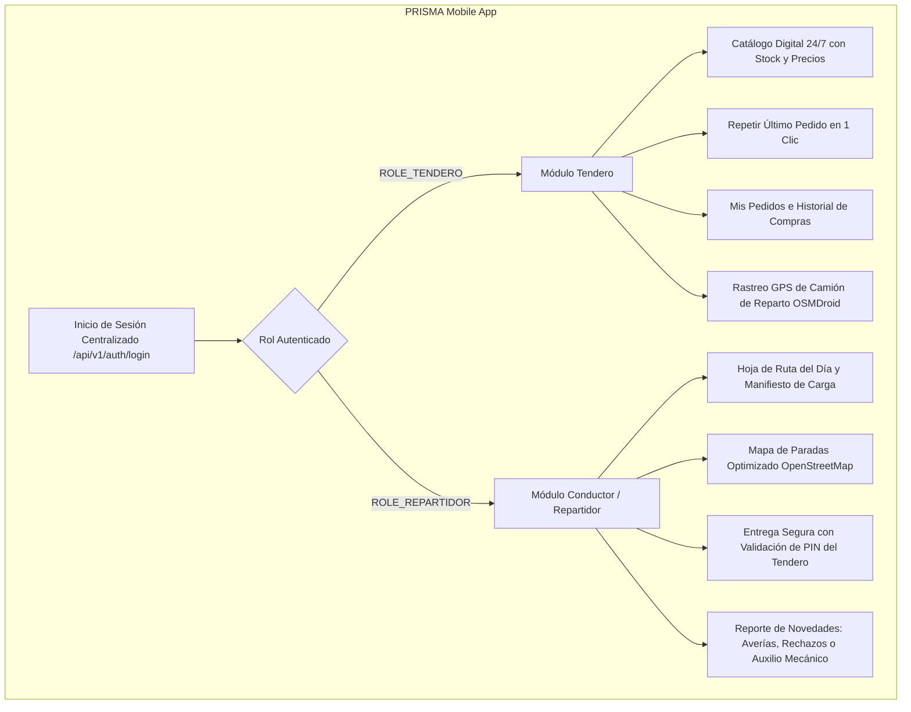

# PRISMA Mobile App (Android Nativo)

[-3DDC84?logo=android&logoColor=white)](https://developer.android.com)
[](https://kotlinlang.org)
[](https://gradle.org)
[](https://square.github.io/retrofit/)
[%20%240%20USD-green?logo=openstreetmap&logoColor=white)](https://osmdroid.github.io/osmdroid/)
[](LICENSE)

Aplicación móvil nativa en Android / Kotlin para la plataforma B2B PRISMA, diseñada con arquitectura ligera y costo $0 USD para digitalizar las operaciones en calle de dos actores críticos: Tenderos de barrio y Conductores / Repartidores de camión.

---

## Roles y Funcionalidades Principales



### 1. Experiencia del Tendero (ROLE_TENDERO)
* **Catálogo 24/7:** Visualización categorizada de productos de marcas mayoristas (Coca-Cola, Postobón, Brisa, Del Valle) sin depender de visitas presenciales.
* **Reorden Rápido:** Capacidad de duplicar el pedido habitual ante quiebres de inventario no planificados en un solo tap.
* **Seguimiento GPS Low-Cost:** Visualización en mapa OpenStreetMap de la ubicación aproximada del camión en ruta hacia la tienda.

### 2. Experiencia del Conductor / Repartidor (ROLE_REPARTIDOR)
* **Manifiesto de Carga:** Lista consolidada de bultos y pedidos asignados para la jornada de entrega.
* **Ruta de Despacho:** Secuencia ordenada de paradas con datos de contacto de cada tienda y navegación en mapa.
* **Prueba de Entrega Digital:** Cierre seguro de entrega requiriendo el PIN secreto proporcionado por el tendero, eliminando planillas físicas de papel.

---

## Stack Tecnológico y Dependencias

| Componente | Tecnología / Librería | Versión | Propósito |
| :--- | :--- | :--- | :--- |
| **Lenguaje** | Kotlin | 1.9+ | Desarrollo nativo con Coroutines y Type Safety |
| **SDK Android** | Android SDK 34 (Min 24 / Target 34) | API 24+ | Compatibilidad con dispositivos Android 7.0 Nougat en adelante |
| **Arquitectura** | MVVM / ViewBinding | Android Jetpack | Enlace seguro de vistas sin `findViewById` y separación lógica |
| **Networking** | Retrofit 2 + OkHttp 3 / Logging Interceptor | 2.11.0 / 4.12.0 | Cliente REST con serialización Gson y gestión de tokens |
| **Seguridad** | `androidx.security:security-crypto` | 1.1.0-alpha06 | `EncryptedSharedPreferences` para almacenar credenciales/JWT de forma cifrada sin costo |
| **Mapas & GPS** | OSMDroid (`org.osmdroid:osmdroid-android`) | 6.1.18 | Renderizado de mapas vectoriales OpenStreetMap sin costos de API Key de Google Maps |
| **Testing** | JUnit 4, Espresso Core, AndroidX Test | 4.13.2 / 3.6.1 | Pruebas unitarias de parsing/lógica y pruebas instrumentadas de UI |

---

## Estructura del Código

```
android/
├── build.gradle.kts                   # Configuración del proyecto raíz Gradle
├── settings.gradle.kts                # Repositorios y módulos (PRISMA-Mobile)
├── gradlew / gradlew.bat              # Gradle Wrapper ejecutable
├── gradle/wrapper/                    # Binarios Gradle Wrapper
└── app/
    ├── build.gradle.kts               # Configuración del módulo, dependencias y buildConfig
    ├── proguard-rules.pro             # Reglas de ofuscación para Release
    └── src/main/
        ├── AndroidManifest.xml        # Permisos (INTERNET, ACCESS_FINE_LOCATION, ACCESS_NETWORK_STATE)
        ├── res/                       # Layouts XML, Drawables, Strings, Colors y Temas
        └── java/com/prisma/mobile/
            ├── PrismaApplication.kt   # Inicialización global y configuración de OSMDroid User-Agent
            ├── data/
            │   ├── api/               # ApiClient, AuthApiService, TiendaApiService, ConductorApiService
            │   ├── model/             # Data classes (AuthModels, PedidoModels, ProductoModel)
            │   └── session/           # SessionManager cifrado con EncryptedSharedPreferences
            ├── ui/
            │   ├── auth/              # LoginActivity (detección de roles y redirección)
            │   ├── home/              # MainActivity
            │   ├── tendero/           # CatalogoActivity, MisPedidosActivity, RastreoCamionActivity, ProductoAdapter
            │   └── conductor/         # ConductorRouteActivity, ConductorMapaRutaActivity
            └── util/
                └── Constants.kt       # Endpoints de red (Emulador, Wi-Fi Local, Servidor Sabio en Nube)
```

---

## Configuración y Ejecución

### 1. Requisitos Previos
* **Android Studio:** Hedgehog (2023.1.1) o superior (Ladybug / Iguana recomendados).
* **JDK:** OpenJDK 17 LTS (configurado en `Gradle JDK` de Android Studio).
* **Dispositivo de Prueba:**
  * Emulador AVD con Android 7.0 (API 24) o superior con Google APIs.
  * O Celular físico conectado mediante cable USB con Depuración USB activada.

### 2. Configuración de Endpoints de Red
El archivo `app/src/main/java/com/prisma/mobile/util/Constants.kt` gestiona la resolución automática de IPs y servidores según el entorno de ejecución:

```kotlin
// Emulador oficial de Android Studio (redirige automáticamente a localhost de tu PC)
const val EMULATOR_BASE_URL = "http://10.0.2.2:8080/api/v1/"

// Red local Wi-Fi para pruebas con celular físico en la misma red
const val WIFI_BASE_URL = "http://192.168.100.9:8080/api/v1/"

// Servidor público en la nube (acceso directo 4G/LTE sin requerir VPN)
const val DEFAULT_BASE_URL = "https://server-sabio.tail2474b3.ts.net:8443/api/v1/"
```

> [!NOTE]
> La aplicación cuenta con una política de seguridad de red en `res/xml/network_security_config.xml` que permite tráfico HTTP local de desarrollo para `10.0.2.2` y redes privadas `192.168.x.x`, forzando HTTPS en entornos remotos.

### 3. Compilación desde Terminal

```bash
# Otorgar permisos de ejecución al wrapper (Linux/macOS)
chmod +x gradlew

# Compilar APK en modo Debug
./gradlew assembleDebug

# Ejecutar pruebas unitarias locales
./gradlew testDebugUnitTest
```

El APK resultante se genera en:
`app/build/outputs/apk/debug/app-debug.apk`

---

## Seguridad y Buenas Prácticas
* **Tokens sin persistencia en texto plano:** Los tokens JWT no se guardan en `SharedPreferences` convencionales; se utiliza `MasterKey` con esquema `AES256_GCM` mediante `EncryptedSharedPreferences`.
* **Zero Cost Strategy:** Uso de OpenStreetMap y OSMDroid para la geolocalización de camiones y tiendas, garantizando $0 USD de consumo en facturación de APIs de terceros.

---

## Equipo y Atribución
Proyecto desarrollado en el marco del curso de IETI (Ingeniería de Software y Tecnologías de Internet) en la Escuela Colombiana de Ingeniería Julio Garavito.

* **Organización GitHub:** [ECIPrisma](https://github.com/ECIPrisma)
* **Licencia:** Apache 2.0 - Consulta el archivo [LICENSE](LICENSE) para más detalles.
